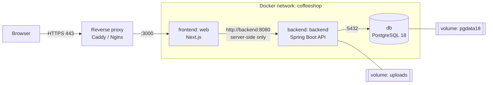
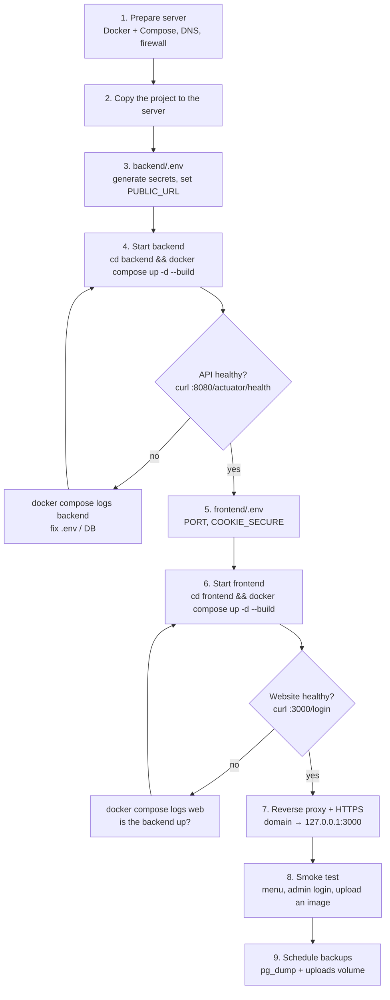
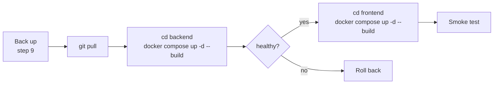

# Deploying CoffeeShop

How to put the backend (Spring Boot API + PostgreSQL) and the frontend (Next.js website) on a server with Docker, and how to keep it running: updates, backups, restore and rollback.

## What runs where



| Container | Compose file | Image | Port (host → container) | Data |
| --- | --- | --- | --- | --- |
| `db` | `backend/docker-compose.yml` | `postgres:18-alpine` | `127.0.0.1:5433 → 5432` | volume `coffeeshop-backend_pgdata18` |
| `backend` | `backend/docker-compose.yml` | built from `backend/Dockerfile` | `8080 → 8080` | volume `coffeeshop-backend_uploads` (images) |
| `web` | `frontend/docker-compose.yml` | built from `frontend/Dockerfile` | `3000 → 3000` | none (stateless) |

- The browser only ever talks to the website. The website calls the API server-to-server, and uploaded images are proxied through the website at `/uploads/*`.
- **The only thing that needs to be public is the website** (behind HTTPS). The API port can stay private; the database is already bound to `127.0.0.1`.

## Deploy flow at a glance



---

## 1. Prepare the server

- Linux server (Ubuntu 22.04+ or similar) with at least **2 GB RAM**. The API's JVM and the image builds need it.
- Docker Engine 24+ and the Compose plugin v2: `docker --version`, `docker compose version`.
- A domain name pointing at the server (an `A` record), e.g. `coffeeshop.example.com`.
- Firewall: allow **22** (SSH), **80** and **443**. Don't open 3000, 8080 or 5433 to the internet.

## 2. Copy the project to the server

```bash
git clone <your-repo-url> /opt/coffeeshop      # or scp/rsync the folder
cd /opt/coffeeshop
```

Never copy your local `backend/.env`; create a fresh one on the server, as in the next step.

## 3. Configure the backend (`backend/.env`)

```bash
cd /opt/coffeeshop/backend
cp .env.example .env
```

Edit `.env`:

| Variable | Production value |
| --- | --- |
| `DB_PASSWORD` | `openssl rand -base64 24` |
| `JWT_SECRET` | `openssl rand -base64 48` (at least 32 characters; changing it later logs everyone out) |
| `ADMIN_EMAIL` / `ADMIN_PASSWORD` | The first admin, created on first start only. Use a strong password. |
| `PUBLIC_URL` | `https://coffeeshop.example.com` (the website's address, used for CORS) |
| `SWAGGER_ENABLED` | `false`, unless you want the API docs public |
| `BACKEND_PORT` | `127.0.0.1:8080`, so the API is reachable only from the server itself |
| `DB_PORT` | `5433`; it's already bound to `127.0.0.1` in the compose file |

`.env` holds secrets: `chmod 600 .env`. It's gitignored and excluded from the Docker image.

## 4. Start the backend

```bash
cd /opt/coffeeshop/backend
docker compose up -d --build
docker compose ps                                   # db and backend: "healthy"
curl -s http://127.0.0.1:8080/actuator/health       # {"status":"UP"}
docker compose logs backend | grep -E "Flyway|migrations|admin account"
```

On first start:
- Flyway creates the tables and loads the starter menu (`V1`, `V2`).
- The API creates the admin from `ADMIN_EMAIL` / `ADMIN_PASSWORD`.
- The compose file creates the Docker network `coffeeshop`, which the frontend needs.

## 5. Configure the frontend (`frontend/.env`)

```bash
cd /opt/coffeeshop/frontend
cp .env.example .env
```

| Variable | Production value |
| --- | --- |
| `PORT` | `127.0.0.1:3000` when a reverse proxy runs on the same server. Otherwise `3000`. |
| `COOKIE_SECURE` | `true` (the default). The site must then be served over HTTPS; see step 7. |
| `SITE_URL` | `https://coffeeshop.example.com`, your public address. The QR code at `/admin/qr` points here. |
| `BACKEND_URL` | Leave unset. Inside Docker the default `http://backend:8080` is correct. |

## 6. Start the frontend

```bash
cd /opt/coffeeshop/frontend
docker compose up -d --build
docker compose ps                                          # web: "healthy"
curl -s -o /dev/null -w "%{http_code}\n" http://127.0.0.1:3000/login    # 200
```

The backend must be running first: the frontend joins its network.

## 7. Reverse proxy and HTTPS

Put a reverse proxy in front of the website for TLS. With **Caddy** on the host (automatic Let's Encrypt certificates), `/etc/caddy/Caddyfile`:

```caddyfile
coffeeshop.example.com {
    encode gzip
    reverse_proxy 127.0.0.1:3000
}
```

`sudo systemctl reload caddy`, then open https://coffeeshop.example.com.

With **Nginx**, allow image uploads (5 MB plus overhead) and forward the headers:

```nginx
server {
    server_name coffeeshop.example.com;
    client_max_body_size 8m;              # image uploads
    location / {
        proxy_pass http://127.0.0.1:3000;
        proxy_set_header Host $host;
        proxy_set_header X-Forwarded-For $proxy_add_x_forwarded_for;
        proxy_set_header X-Forwarded-Proto $scheme;
    }
    # listen 443 ssl; + certbot-managed certificate lines
}
```

You only need to expose the API, e.g. on `api.coffeeshop.example.com → 127.0.0.1:8080`, if you want Swagger or other clients to reach it from outside.

## 8. Smoke test

1. `https://coffeeshop.example.com` shows the menu with no login.
2. Click the person icon → log in with the admin account → you land on `/admin`.
3. **Products → add**: upload a photo with the image button and save. It appears on the public menu.
4. Register a test customer at `/register` and log in: `/admin` is view-only (banner, no edit buttons). Delete that test account afterwards if you like.
5. Open `/admin/qr`, scan a code with a phone, and check it opens your domain (not `localhost`). Then download or print the codes.

## 9. Backups

Back up the database **and** the uploaded images; the images aren't in the database.

```bash
# database (custom format, includes everything Flyway created)
docker exec coffeeshop-backend-db-1 pg_dump -U coffeeshop -d coffeeshop -Fc > backup-$(date +%F).dump

# uploaded images
docker run --rm -v coffeeshop-backend_uploads:/data -v "$PWD":/backup alpine \
  tar czf /backup/uploads-$(date +%F).tar.gz -C /data .
```

Run these from cron (e.g. nightly) and copy the files off the server. The dumps contain user accounts with password hashes, so store them privately.

---

## Updating to a new version



```bash
cd /opt/coffeeshop && git pull
(cd backend && docker compose up -d --build)     # Flyway applies any new migrations on start
(cd frontend && docker compose up -d --build)
```

- **Volumes are kept** across rebuilds, so data and images stay.
- **Schema changes are automatic.** New `V<n>__*.sql` files in `backend/src/main/resources/db/migration` run on start. Back up first; a migration can't be undone automatically.
- Optional, before deploying: `cd backend && ./mvnw verify` and `cd frontend && npm test`. The backend suite needs Docker for Testcontainers.

## Rollback

1. Check out the previous version (`git checkout <tag-or-commit>`) and rebuild both stacks, as in an update.
2. If the bad version **ran a database migration**, restore the backup taken before the update:

```bash
cd /opt/coffeeshop/backend
docker compose stop backend
docker exec -i coffeeshop-backend-db-1 pg_restore -U coffeeshop -d coffeeshop --clean --if-exists --no-owner < backup-YYYY-MM-DD.dump
docker compose up -d backend
```

Restoring uploads: `docker run --rm -v coffeeshop-backend_uploads:/data -v "$PWD":/backup alpine sh -c "cd /data && tar xzf /backup/uploads-YYYY-MM-DD.tar.gz"`.

## Upgrading PostgreSQL to a new major version

A major version (e.g. 18 → 19) **can't read the previous version's data folder**. Never just change the image tag on an existing volume. Instead:

1. Dump with the old version: `docker exec coffeeshop-backend-db-1 pg_dump -U coffeeshop -d coffeeshop -Fc > pre-upgrade.dump`.
2. In `backend/docker-compose.yml`, change the image and use a **new** volume name (e.g. `pgdata19`). Check the new image's docs for its data directory.
3. Start only the database: `docker compose up -d db`, then restore: `docker exec -i coffeeshop-backend-db-1 pg_restore -U coffeeshop -d coffeeshop --no-owner < pre-upgrade.dump`.
4. Start the API: `docker compose up -d --build`. Flyway reports "Schema is up to date".
5. Once everything works, delete the old volume: `docker volume rm coffeeshop-backend_pgdata<old>`.

This is exactly how the move from PostgreSQL 16 to 18 was done. The old 16 volume `coffeeshop-backend_pgdata` and a dump in `backend/backups/` were kept as a fallback, and can be deleted once you're happy.

## Logs and health

```bash
cd backend && docker compose logs -f backend        # API (Spring Boot)
cd backend && docker compose logs -f db             # PostgreSQL
cd frontend && docker compose logs -f web           # website (Next.js)
docker ps --format '{{.Names}}  {{.Status}}'        # every container should be "healthy"
```

Health checks: the API at `GET /actuator/health/readiness`, the website at `GET /login`. Docker restarts crashed containers (`restart: unless-stopped`).

## Security checklist

- [ ] `JWT_SECRET`, `DB_PASSWORD` and `ADMIN_PASSWORD` are long and random, and unique to this server.
- [ ] `backend/.env` is `chmod 600` and not in git.
- [ ] Only 22, 80 and 443 are open; `BACKEND_PORT` and `PORT` are bound to `127.0.0.1` behind the proxy.
- [ ] The site is served over HTTPS (`COOKIE_SECURE=true`).
- [ ] `SWAGGER_ENABLED=false`, unless you deliberately expose the API docs.
- [ ] Nightly backups of the database and uploads, copied off the server.
- [ ] Rate limiting on `/login` at the proxy. The API has none yet.

Known gaps: there's no password-reset or change-password screen yet. To change the admin password, update it in the database, or delete the admin user and restart the API with new `ADMIN_*` values.

## Troubleshooting

| Symptom | Likely cause / fix |
| --- | --- |
| `network coffeeshop declared as external, but could not be found` | Start the backend first; it creates the network. |
| API exits with `JWT_SECRET … must be at least 32 characters` | Set `JWT_SECRET` in `backend/.env`. |
| `db` keeps restarting after an image change | The data volume is from another PostgreSQL major version. See "Upgrading PostgreSQL". |
| Menu says "can't load the menu" (មិនអាចផ្ទុកម៉ឺនុយបានទេ) | The API is down or unhealthy: `cd backend && docker compose ps`, then check the logs. |
| Login works but you're sent straight back to `/login` | The site is on plain HTTP while `COOKIE_SECURE=true`. Use HTTPS, or `COOKIE_SECURE=false` only on a trusted LAN. |
| Image upload fails with "too large" behind Nginx | Raise `client_max_body_size` to at least 8 MB. |
| Port already in use | Change `PORT` / `BACKEND_PORT` / `DB_PORT` in the `.env` files. |

## Local development (no reverse proxy)

| What | URL |
| --- | --- |
| Website | http://localhost:3000 |
| API | http://localhost:8080 |
| Swagger UI | http://localhost:8080/swagger-ui.html |
| PostgreSQL | `localhost:5433` (user `coffeeshop`) |

Without Docker, run `cd backend && docker compose up -d db && ./mvnw spring-boot:run -Dspring-boot.run.profiles=dev`, then `cd frontend && npm run dev`.
